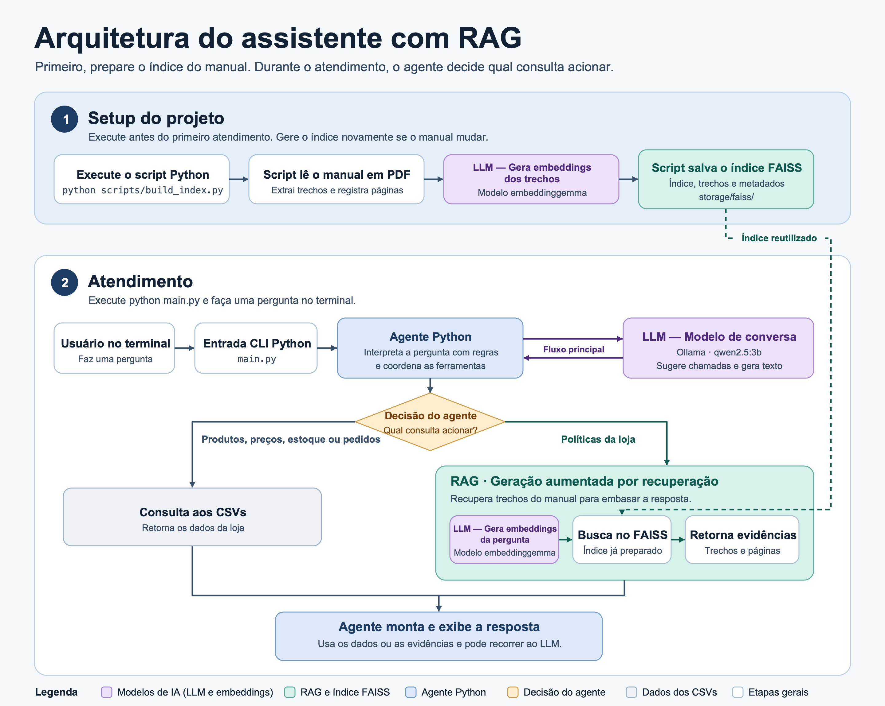

# Assistente de atendimento com RAG

## O que é o projeto?

Um assistente de atendimento pelo terminal para uma loja fictícia de instrumentos musicais. Ele consulta arquivos CSV para responder sobre produtos, preços, estoque e pedidos. Para perguntas sobre trocas, devoluções e entregas, usa RAG para recuperar trechos do manual de políticas e indicar as páginas usadas como referência.

O projeto usa dados de demonstração. Os modelos de conversa e de embeddings rodam localmente com o Ollama.

O [manual de políticas de demonstração](data/documents/politicas_demo.pdf) mantém as regras e as páginas do documento usado no desenvolvimento. O nome da loja e os dados de contato foram substituídos por identificadores fictícios.

## Arquitetura do projeto

A aplicação Python tem dois fluxos.

1. **Preparação do índice.** Durante a configuração, você executa `python scripts/build_index.py`. O script abre o manual em PDF, divide o texto em trechos e registra a página de origem de cada um. Depois, usa o Ollama para gerar os embeddings e salva o índice FAISS, os trechos e os metadados em `storage/faiss/`.
2. **Atendimento.** O `main.py` inicia a sessão no terminal. O agente Python coordena as chamadas ao modelo de conversa e às ferramentas. As perguntas sobre produtos, preços, estoque e pedidos acionam consultas aos CSVs. Quando a pergunta exige uma consulta de política, a ferramenta `consult_policy` usa o Ollama para gerar um embedding da pergunta e busca trechos no índice FAISS já preparado.



Veja também o [contexto do sistema](docs/architecture/01-system-context.md) e o [fluxo RAG](docs/architecture/04-rag-flow.md).

### Estrutura do projeto

```text
.
├── main.py                       # Inicia a sessão no terminal
├── src/loja_exemplo_assistant/    # Agente, ferramentas e busca RAG
├── scripts/
│   ├── build_index.py            # Gera o índice a partir do manual
│   └── smoke_grounded.py         # Verifica os fluxos de atendimento
├── data/
│   ├── csv/                      # Dados da loja
│   └── documents/                # Manual de políticas em PDF
├── docs/architecture/            # Documentação e diagrama da arquitetura
├── storage/faiss/                # Índice, trechos e metadados gerados
└── tests/                        # Testes automatizados
```

### Formatos de dados

| Formato | Uso no projeto |
|---|---|
| CSV | Fonte dos dados de produtos, categorias, promoções, pedidos e clientes. |
| PDF | Manual de políticas em `data/documents/politicas_demo.pdf`, lido durante a indexação. |
| FAISS | Índice vetorial gerado em `storage/faiss/index.faiss`. |
| JSON | `chunks.json` guarda os trechos e suas páginas. `metadata.json` registra o modelo de embeddings, a dimensão dos vetores e a quantidade de trechos. |

## Como rodar o projeto

### Requisitos

- Python 3.11 ou superior.
- [Ollama instalado](https://ollama.com/) e em execução. Se necessário, abra o aplicativo ou rode `ollama serve` em outro terminal.

A execução local com Ollama dispensa chave de API.

### 1. Instalação e configuração

Na raiz do repositório, crie o ambiente virtual e instale as dependências.

**macOS ou Linux**

```bash
python3 -m venv .venv
source .venv/bin/activate
python -m pip install -e ".[dev]"
```

**Windows com PowerShell**

```powershell
py -3 -m venv .venv
.\.venv\Scripts\Activate.ps1
python -m pip install -e ".[dev]"
```

Para personalizar a configuração, copie `.env.example` para `.env` com `cp .env.example .env` no macOS ou Linux, ou `Copy-Item .env.example .env` no PowerShell. Com os valores padrão, você pode pular essa etapa.

| Variável | Padrão | Uso |
|---|---|---|
| `OLLAMA_CHAT_MODEL` | `qwen2.5:3b` | Modelo de conversa local. Baixe o modelo escolhido com `ollama pull`. |
| `RAG_TOP_K` | `3` | Quantidade de trechos candidatos por pergunta de política. Aceita inteiros de `1` a `5`. |

Baixe os modelos de conversa e de embeddings.

```bash
ollama pull qwen2.5:3b
ollama pull embeddinggemma
```

Gere o índice de políticas.

```bash
python scripts/build_index.py
```

Quando aparecer `Índice criado`, os arquivos estarão disponíveis em `storage/faiss/`. Gere o índice novamente se atualizar o manual ou mudar o modelo de embeddings no código.

### 2. Uso

Inicie o assistente.

```bash
python main.py
```

Quando aparecer o prompt `Cliente:`, experimente uma pergunta de cada fluxo.

| Digite no terminal | O que você deve ver |
|---|---|
| `O produto 81 está disponível em estoque?` | Uma resposta indicando 12 unidades em estoque nos dados de demonstração. |
| `Quero SEDEX` | Uma resposta com o prazo de 2 a 5 dias úteis para localidades fora da região metropolitana e referência à página 5 do manual. |

Digite `sair` para encerrar a sessão.

O assistente consulta número e e-mail para localizar pedidos. Essa consulta não autentica a identidade do cliente. Para alterar pedidos, processar pagamentos, iniciar devoluções ou selecionar frete, procure o atendimento humano.

### 3. Testes

A suíte automatizada usa respostas simuladas do Ollama.

```bash
python -m pytest -q
```

Com o Ollama em execução e o índice gerado, rode o roteiro que verifica as respostas de preço, estoque, pedidos e entrega.

```bash
python scripts/smoke_grounded.py
```

A mensagem `Teste concluído` indica que as verificações passaram.
