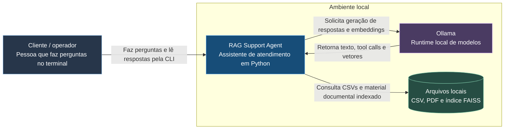

<!-- Este documento descreve o contexto do sistema, seus usuários e as dependências externas à aplicação. -->

# Contexto do sistema

## Objetivo

Mostrar qual é a responsabilidade do sistema e quais dependências estão fora do limite da aplicação.

## Diagrama

## Responsabilidades e fronteiras

| Elemento | Responsabilidade | Limite |
|---|---|---|
| Cliente / operador | Digita perguntas e recebe respostas no terminal. | Fora da aplicação. |
| RAG Support Agent | Coordena o atendimento, consulta ferramentas e responde com base nos dados disponíveis. | Sistema em estudo. |
| Ollama | Executa localmente o modelo de chat (`qwen2.5:3b`) e o modelo de embeddings (`embeddinggemma`). | Runtime separado, embora na mesma máquina. |
| Arquivos locais | Fornecem produtos, pedidos e promoções por CSV; o manual PDF é a fonte para gerar o índice FAISS consultado durante o atendimento. | Persistência em disco, não um serviço externo. |

## O que o sistema faz

- Consulta produtos disponíveis, preços, descontos e status de pedidos.
- Recupera trechos do manual de políticas com indicação de página por meio de RAG.
- Mantém o contexto de conversa em memória apenas durante a sessão em execução.
- Restringe respostas factuais a consultas e evidências recuperadas.

## O que o sistema não faz

Não altera pedidos, processa pagamentos, inicia devoluções, autentica clientes nem utiliza uma API de nuvem para os modelos. A conferência de número de pedido e e-mail serve apenas como filtro da consulta, **não como autenticação**.

## Próxima visão

Veja [02-containers.md](02-containers.md) para entender os processos e armazenamentos locais.
