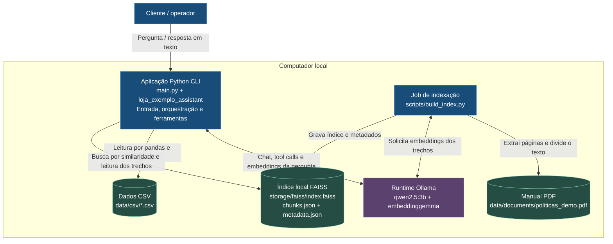

<!-- Este documento descreve os processos executáveis e os armazenamentos que compõem a solução. -->

# Contêineres da solução

## Objetivo

Mostrar os **processos executáveis e os armazenamentos** que compõem a solução.

## Diagrama

## Inventário

| Contêiner / armazenamento | Tecnologia | Papel |
|---|---|---|
| Aplicação CLI | Python 3.11+, execução de `main.py` | Recebe mensagens, executa o agente e gerencia as ferramentas. |
| Runtime de modelos | Ollama | Modelo de chat (`qwen2.5:3b`, configurável) e embeddings (`embeddinggemma`, configurado no retriever e registrado nos metadados do índice). |
| Tabelas locais | CSV + pandas | Dados de produtos, categorias, promoções, pedidos e clientes. Existem também `order_items.csv` na pasta de dados. |
| Manual | PDF + pypdf | Fonte original para indexação das políticas da loja. |
| Índice vetorial | FAISS + JSON | Índice de similaridade e trechos com metadados, gerados localmente. |
| Job de indexação | Script Python, NumPy, Ollama e FAISS | Transforma o PDF em chunks, embeddings e índice. Executado antes do atendimento. |

## Fluxos distintos

**Preparação (offline):** `python scripts/build_index.py` lê o PDF, usa o `embeddinggemma` e grava `index.faiss`, `chunks.json` e `metadata.json`.

**Atendimento (runtime):** `python main.py` inicia uma sessão; o agente usa o modelo de chat, consulta ferramentas e, quando necessário, faz buscas no índice já criado. **O PDF não é novamente indexado a cada pergunta.**

## Decisões observadas

- A solução funciona localmente: não há serviço web, banco SQL, contêiner Docker nem provedor OpenAI implementado nessa branch.
- O índice FAISS é um conjunto de arquivos em `storage/faiss/`, não um servidor separado.
- O histórico da conversa não é salvo em disco: reside na instância de `Session` durante a execução.
- O modelo de chat é configurado por `OLLAMA_CHAT_MODEL`; o `RAG_TOP_K` aceita valores entre 1 e 5.

## Próxima visão

Veja [03-components.md](03-components.md) para o interior da aplicação Python.
