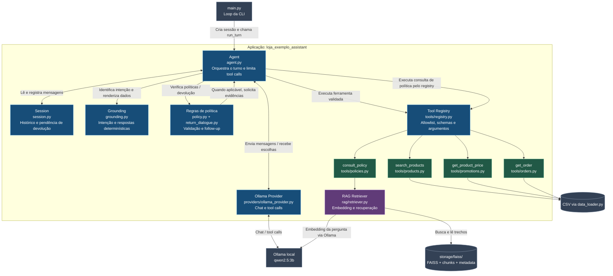

<!-- Este documento apresenta os componentes internos da aplicação Python e suas principais conexões. -->

# Componentes internos da aplicação Python

## Objetivo

Mostrar as responsabilidades internas de `loja_exemplo_assistant` e as conexões mais importantes entre elas. O diagrama é uma **visão lógica de componentes**, não um grafo de todas as chamadas de função.

## Diagrama

## Principais componentes

| Componente | Arquivo | Responsabilidade concreta |
|---|---|---|
| Entrada | `main.py` | Cria `Session`, lê perguntas e exibe respostas. |
| Agent | `agent.py` | Orquestra um turno, chama modelo/ferramentas, impõe `MAX_TOOL_CALLS = 4` e define respostas de fallback. |
| Session | `session.py` | Mantém `messages` e `pending_return_question` em memória. |
| Grounding | `grounding.py` | Detecta intenções de dados, seleciona consultas obrigatórias e transforma resultados estruturados em texto controlado. |
| Regras e diálogo | `policy.py`, `return_dialogue.py` | Trata exigências de evidência, resumos de política e a pergunta online/presencial. |
| Modelo | `providers/ollama_provider.py` | Chama Ollama, adapta mensagens e resultados de Function Calling. |
| Catálogo de ferramentas | `tools/registry.py` | Publica schemas, valida parâmetros e permite apenas as quatro ferramentas cadastradas. |
| Ferramentas de dados | `tools/products.py`, `tools/promotions.py`, `tools/orders.py` | Consultam CSVs de produtos, promoções e pedidos. |
| Ferramenta de política | `tools/policies.py` | Chama o retriever com `RAG_TOP_K`. |
| Retriever | `rag/retriever.py` | Gera embedding da pergunta, compara com o FAISS, aplica limiar mínimo e retorna trechos com página e score. |

## Duas estratégias de resposta

1. **Dados estruturados:** quando `grounding.py` identifica uma intenção de produto, preço ou pedido, o agente seleciona a chamada de ferramenta obrigatória com os argumentos extraídos da pergunta e do histórico. A resposta final é composta deterministicamente dos campos retornados. Se a intenção não for identificada, o fluxo pode seguir a escolha de ferramenta do modelo.
2. **Políticas:** o agente força `consult_policy` para pedidos de política quando necessário. As evidências recuperadas orientam a resposta e `policy.py` aplica verificações específicas e referências de página.

### Restrições e cuidados

- Os argumentos passam pelo `registry.py`; ferramentas fora da allowlist não são executadas.
- Para consulta de pedido, é necessário número **e** e-mail, mas isso não equivale a autenticação.
- O assistente não executa ações de escrita em pedidos, pagamento ou devolução.
- Os trechos do PDF são dados não confiáveis como instruções: o prompt orienta o modelo a não tratá-los como comandos.
- `MAX_TOOL_CALLS = 4` limita chamadas de ferramentas por turno no fluxo principal; caminhos diretos, como a resolução do diálogo de devolução e a consulta de modalidades de frete, têm lógica própria.
- O diálogo de devolução pode ser resolvido localmente por `return_dialogue.py`; quando precisa de evidência, o agente registra uma chamada a `consult_policy` e usa a resposta da política para concluir o fluxo.

## Próxima visão

Veja [04-rag-flow.md](04-rag-flow.md) para os fluxos de preparação e consulta de documentos.
