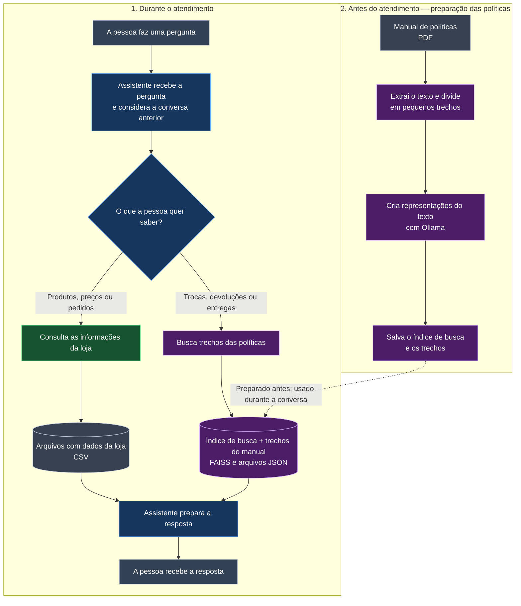

# Como funciona o assistente da loja

## Objetivo

Mostrar o caminho de uma pergunta até a resposta.

## Entenda em poucas palavras

- **Pergunta:** a pessoa conversa com o assistente pelo terminal.
- **Informações da loja:** quando a pergunta é sobre produtos, preços ou pedidos, o assistente consulta os dados em arquivos CSV.
- **Políticas da loja:** quando a pergunta é sobre trocas, devoluções ou entregas, o assistente pesquisa trechos já preparados do manual.
- **Resposta:** o assistente utiliza as informações encontradas e as regras da aplicação para responder. Se não houver informação suficiente, pode orientar a pessoa a procurar atendimento humano.

## O que acontece antes da conversa?

O manual em PDF é lido **na preparação do sistema**. Seu texto é dividido em trechos e transformado em um índice de busca, com apoio de um modelo de embeddings executado pelo Ollama. **Durante o atendimento, a busca utiliza o índice FAISS e os arquivos com trechos e metadados; ela não abre o PDF novamente.**

> **Simplificação intencional:** o diagrama não detalha cada ferramenta, as chamadas ao modelo, as regras específicas de devolução e frete, nem o limite de quatro chamadas de ferramentas do fluxo principal. Esses detalhes continuam implementados no código.
